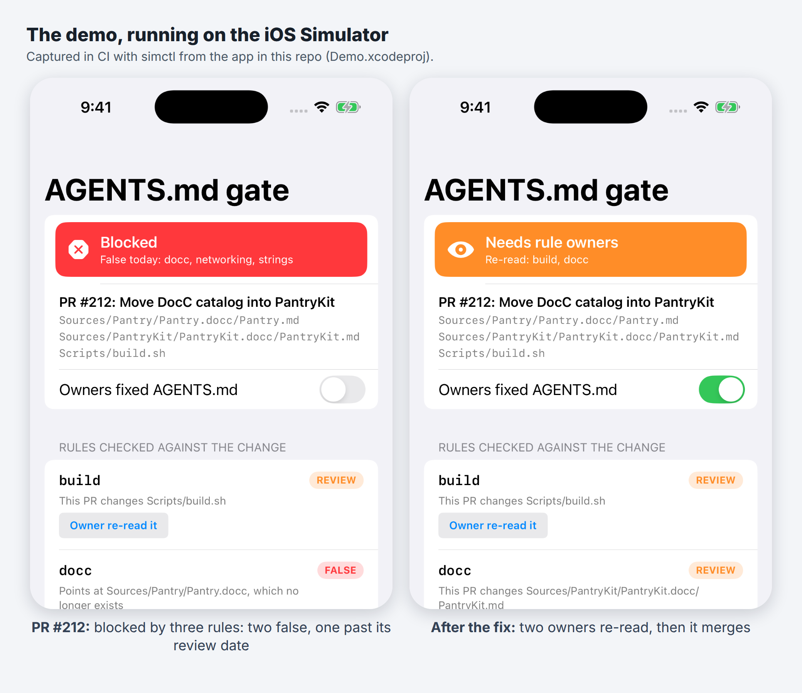
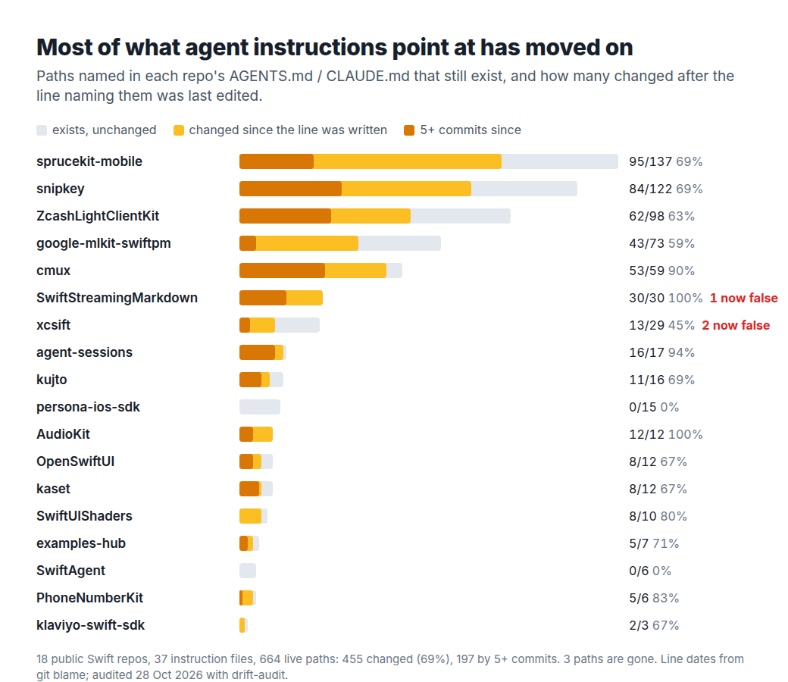
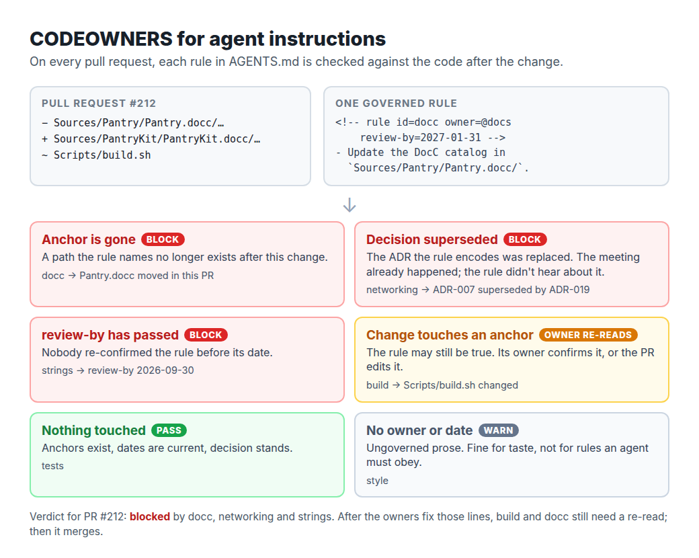

# InstructionDrift

**Your AGENTS.md is a future lie. This package measures how fast, and gates pull requests so it stops.**

Article: (added after publish)

`InstructionDrift` treats agent instruction files (`AGENTS.md`, `CLAUDE.md`) as code that describes other code. It does two things:

1. **Audits drift.** It finds every path an instruction file names, checks the path still exists, and uses `git blame` to count how many commits have touched it since the sentence about it was last edited.
2. **Gates pull requests (library API).** Rules carry an owner, a `review-by` date, the decision (ADR) they encode, and anchors. On each PR, a rule whose anchor is gone, whose date has passed, or whose ADR was superseded **blocks** the merge, and a rule whose anchored code changed needs its **owner to re-read it**. CODEOWNERS for agent instructions.



## What I found in 18 public Swift repos

`Tools/drift-audit` was run on 18 public Swift repos that ship an `AGENTS.md` or `CLAUDE.md` (37 instruction files, 779 path references):

- **664** references still resolve. **455 of them (69%)** point at code that changed after the line naming it was last edited; **197** at code with five or more commits since.
- **3** references point at paths that are gone, in 2 repos. One is a `you MUST update ... Sources/xcsift.docc/` rule: the catalog moved nearly five months before the file's most recent edit.

Method, per-repo numbers, commits and the hand check of every removed path: [`docs/field-audit`](docs/field-audit/README.md).



## A governed rule

A rule is a normal Markdown bullet with an HTML comment above it. GitHub renders nothing; an agent pays a few tokens.

```markdown
<!-- rule id=docc owner=@docs review-by=2027-01-31 -->
- When you change public API, you MUST update the DocC catalog in `Sources/Pantry/Pantry.docc/`.

<!-- rule id=networking owner=@ios-platform review-by=2027-02-28 decision=ADR-007 -->
- All requests go through `Sources/PantryKit/Network/APIClient.swift`.
```

## The gate

```swift
import InstructionDrift

let gate = ReviewGate(
    rules: RuleParser.rules(in: agentsMarkdown),
    snapshot: RepoSnapshot(files: filesAfterChange),       // `git ls-files` after the PR
    decisions: ["ADR-007": .superseded(by: "ADR-019")]     // your ADR index
)
let checks = gate.check(changedPaths: prFiles,
                        acknowledged: ["build"],           // "Rules-reviewed: build" in the PR body
                        today: Day(year: 2026, month: 10, day: 28))

switch gate.verdict(for: checks) {
case .blocked(let ids):     print("Blocked:", ids)      // dead anchor, expired, superseded ADR
case .needsReview(let ids): print("Owners re-read:", ids)   // the PR touched an anchor
case .pass:                 print("Instructions still hold")
}
```



## What's in the package

| Type | Job |
|---|---|
| `ReferenceExtractor` | Path-like tokens from code spans and fenced blocks, with their line numbers. Prose is ignored on purpose. |
| `RepoSnapshot` | Tracked files and derived directories; resolves a reference relative to the instruction file, the root, or as a path tail. |
| `DriftAuditor` + `ChangeHistory` | Classifies each reference as live (with commits since its line was written), removed, ignored or unresolved. `RecordedHistory` is the in-memory history the tests and demo use. |
| `RuleParser` / `InstructionRule` / `Day` | Parses `<!-- rule ... -->` annotations; a rule's anchors are its explicit `anchors=` plus every path in its text. |
| `ReviewGate` | Checks rules against a PR and returns `pass`, `needsReview` or `blocked`. |
| `FieldStudy` | The 18-repo results, generated from `docs/field-audit/summary.json`. |
| `SampleWorkspace` | "Pantry", a fictional app with six governed rules and one PR. |

`ReviewGate` is a library API: you supply the changed files, `git ls-files`, your ADR statuses and any `Rules-reviewed:` acknowledgements from your own CI step. `Tools/drift-audit` is a separate package (so the library's `Package.swift` stays a pure library). It is the command-line runner that answers `ChangeHistory` with git. `Scripts/field_audit.sh` re-runs the whole study.

## How to run it

```bash
git clone https://github.com/rajatslakhina/agents-md-drift-article-demo.git
cd agents-md-drift-article-demo
open Demo.xcodeproj        # pick an iPhone Simulator, then Build & Run (⌘R)
```

No other setup: `Demo.xcodeproj` uses the package in this repo through a local package reference. The app has three tabs: **Field audit**, **PR gate** (flip "Owners fixed AGENTS.md" and tap "Owner re-read it" to watch the verdict go from blocked to mergeable) and **Rules**.

Library only:

```bash
swift build && swift test
```

Audit your own repo:

```bash
swift run --package-path Tools/drift-audit drift-audit /path/to/your/repo > drift.json
```

## Verification status

- `swift build -Xswiftc -warnings-as-errors` and `swift test` pass on Linux (Swift 6.1.2) and in this repo's `library` CI job on macOS.
- The `demo-on-simulator` CI job builds `Demo.xcodeproj` with `xcodebuild`, installs and launches the app on an iPhone Simulator with `simctl`, checks the process is still alive, and saves the screenshots in `Demo/Screenshots/`. The figure above is made from those captures.
- The app was not run by hand in a local Xcode for this release.

## License

MIT
